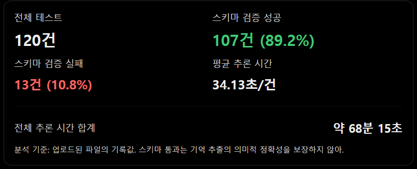
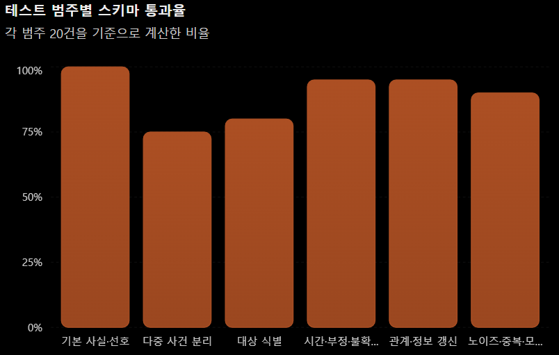
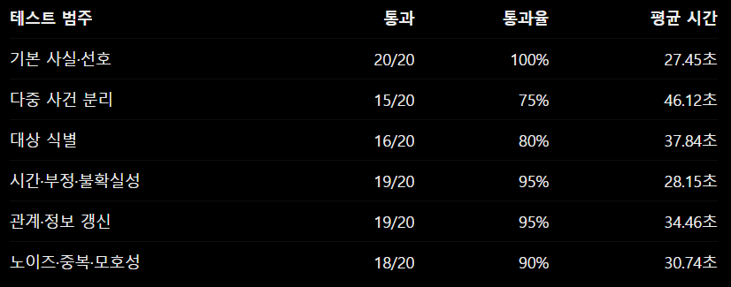

모델별 raw output과 summary JSON을 저장합니다. GGUF 파일명/양자화, llama.cpp 빌드, 컨텍스트 길이, GPU offload 설정을 함께 기록하세요.

- ① 다중 사건 분리가 가장 취약
    - 한 문장이나 기록에 여러 사건이 들어 있을 때 이를 개별 Memory로 분리하는 작업에서 통과율이 75%로 가장 낮았다
    - 평균 처리 시간도 약 46초로 가장 길다
- ② 대상 식별도 추가 검증이 필요
    - 통과율이 80%
    - 우리 프로젝트에서 중요한 동일인·동명이인 구분과 관련되므로, 서로 다른 사람의 정보를 잘못 합치거나 같은 사람을 별개로 분리하는 문제를 의미적으로 확인해야 한다
- ③ 기본 사실과 선호는 구조적으로 안정적이다
    - 20건 모두 스키마 검증을 통과했다. 다만 이것은 출력 형식이 올바르다는 뜻이지, 모든 선호를 정확하게 추출했다는 의미는 아니다

- 실패 원인
    - 빈 출력 8건: raw_output이 비어 있음
    - JSON 파싱 오류 5건: 출력이 유효한 JSON으로 해석되지 않음
    - 따라서 현재 관찰된 문제는 단순한 추출 정확도뿐 아니라 출력 생성의 안정성에도 있다
    - 다만 빈 출력이 발생한 원인이 모델의 생성 중단인지, 실행 환경이나 응답 처리 문제인지는 아직 확정할 수 없다